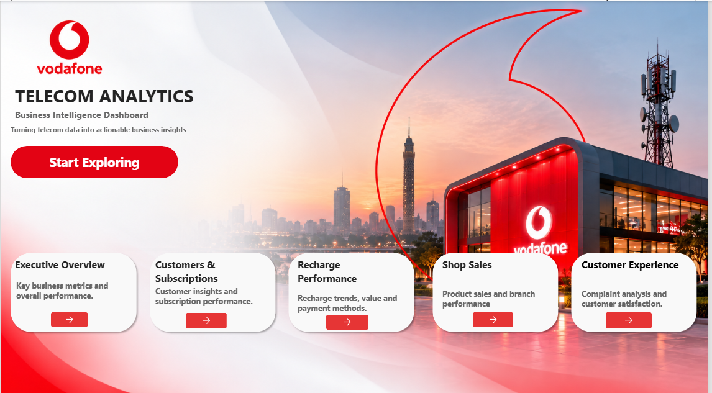
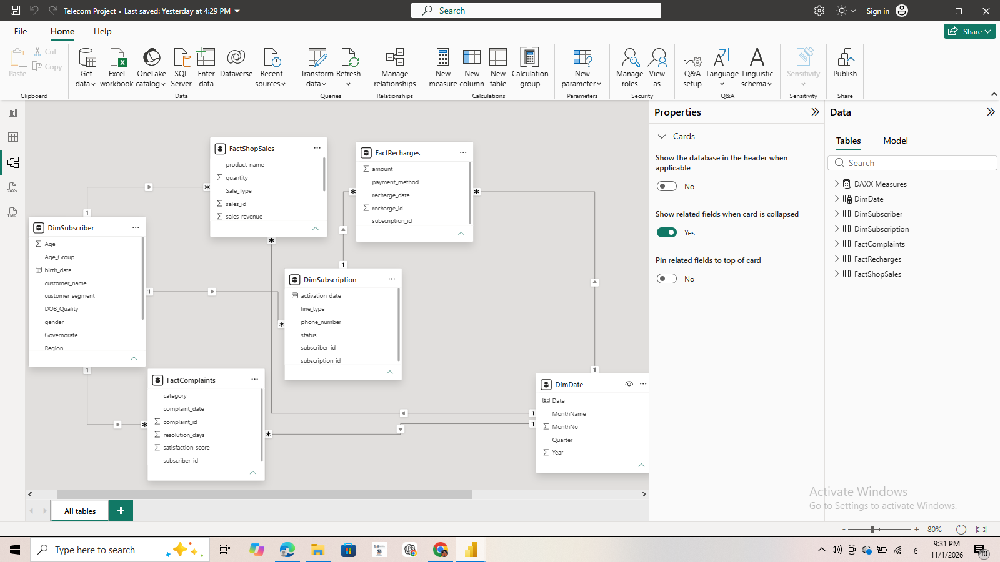
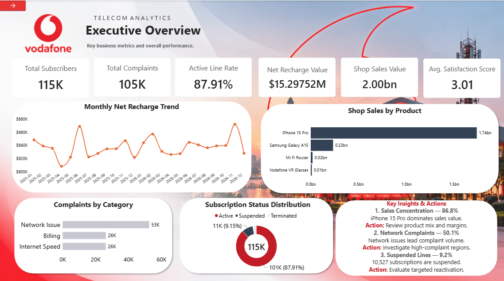
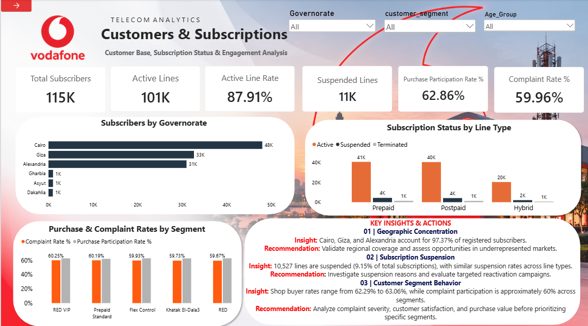
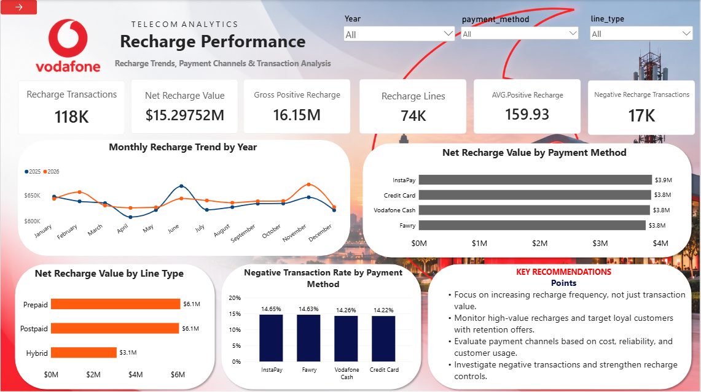
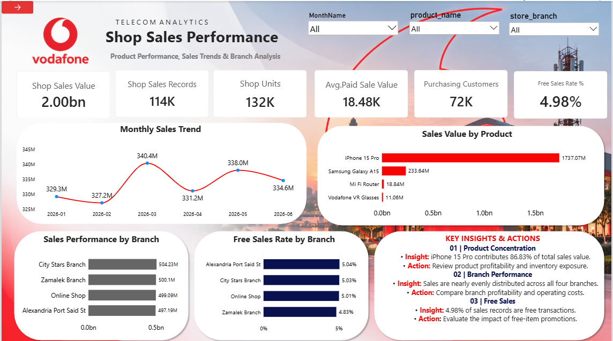
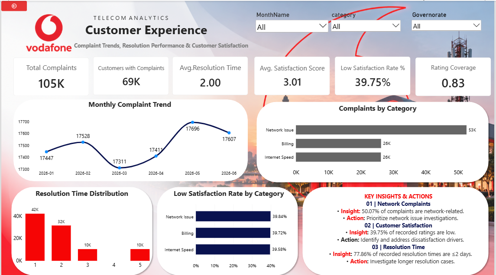

# Vodafone Telecom Analytics | Power BI Business Intelligence Project

**End-to-End BI Project using Power BI, Power Query (ETL), DAX, and Dimensional Data Modeling**

> **At a glance:** 5 CSV source files · **566,541 total source rows** · **24 core KPIs** · **6 report pages** (Landing Page + 5 analytical pages)
>


**Quick links:** [Power BI Report](Dashboard/Vodafone_Telecom_Analytics.pbix) · [Dashboard Pages](#9-dashboard-pages) · [Data Folder](Data/) · [ETL Documentation](Documentation/Data_Cleaning_ETL.md) · [KPI Dictionary](Documentation/KPI_Dictionary.md) · [DAX Reference](Documentation/DAX_Reference.md) · [Model View](Data_Model/Power_BI_Model_View.png)

---

## 1. Project Overview

This project builds a complete telecom business intelligence dashboard in **Power BI** to analyze customer base, subscription activity, recharge behavior, shop sales, and customer experience.

The goal was not only to create visuals, but to build a report that answers real business questions through:
- structured data cleaning and transformation,
- reliable KPI design,
- dimensional data modeling,
- and business-focused insights and recommendations.

### Project Scope

| Item | Details |
|---|---|
| Project Name | Vodafone Telecom Analytics |
| Tool Stack | Power BI, Power Query, DAX, CSV |
| Source Files | 5 CSV datasets |
| Total Source Rows | 566,541 |
| Model Type | Dimensional / Star-like semantic model |
| Report Pages | 1 Landing Page + 5 Analysis Pages |
| Main Topics | Customers, Subscriptions, Recharges, Shop Sales, Complaints |

---

## 2. Business Problem & Objectives

Telecom data is often distributed across different operational datasets. This makes it hard for decision makers to answer questions quickly across customer, transaction, sales, and support domains.

### Business Problem
How can telecom management get a unified view of:
- customer and subscription performance,
- recharge behavior,
- retail sales performance,
- and complaint / satisfaction outcomes,
from multiple disconnected source files?

### Business Objectives
This dashboard was designed to help answer the following:
1. **Customer Base Analysis:** How large is the subscriber base and where is it concentrated?
2. **Subscription Health:** What share of subscriptions is active vs. suspended?
3. **Recharge Monitoring:** How much recharge activity is happening and through which payment methods?
4. **Retail Performance:** Which products and branches drive most shop sales value?
5. **Customer Experience:** What complaint types dominate and how satisfied are customers?
6. **Decision Support:** Turn data into actionable insights and recommendations for the business.

---

## 3. Dataset Description & Data Grain

The project uses five source datasets.

| Dataset | Rows | Grain | Primary Key | Main Purpose |
|---|---:|---|---|---|
| `subscribers(1).csv` | 114,618 | One row per subscriber | `subscriber_id` | Customer profile and segmentation |
| `subscriptions(1).csv` | 114,994 | One row per subscription | `subscription_id` | Line type and status |
| `recharges(1).csv` | 118,025 | One row per recharge transaction | `recharge_id` | Recharge value and payment behavior |
| `shop_sales(1).csv` | 113,904 | One row per sales record | `sales_id` | Shop sales activity |
| `complaints(1).csv` | 105,000 | One row per complaint | `complaint_id` | Complaint, resolution, and satisfaction analysis |

### Why Data Grain Matters
The grain of each table determines how measures are calculated.
For example:
- **Subscribers** are not the same as **subscriptions**.
- **Recharge transactions** are not the same as **recharging customers**.
- **Sales records** are not the same as **units sold**.

This distinction is essential for building correct KPIs and avoiding misleading totals.

---

## 4. Tools & Technologies

| Tool / Technology | Purpose |
|---|---|
| **Power BI Desktop** | Dashboard development and report design |
| **Power Query (ETL)** | Data cleaning, transformation, and shaping |
| **DAX** | KPI creation and business logic |
| **CSV Files** | Raw source data |
| **Markdown / GitHub** | Project documentation and publishing |
| **ETL** | Data preparation workflow before modeling and reporting |

### Why These Tools?
- **Power BI** was the core reporting environment.
- **Power Query** was used because the project is file-based and the transformation logic needed to stay transparent and reproducible inside the BI workflow.
- **DAX** was used for KPI logic and interactive analytics.

---

## 5. Data Architecture

The project follows a simple BI flow:


### Data Journey
1. Raw telecom data is imported from CSV files.
2. Power Query is used to clean, standardize, and validate the data.
3. Data is organized into a dimensional model.
4. DAX measures are created for business KPIs.
5. Interactive report pages are built in Power BI.
6. Insights and recommendations are extracted for decision-making.

---

## 6. Data Cleaning & ETL

A major part of the project was focused on **data cleaning and preparation** before building visuals.

### Key Cleaning & Transformation Steps

| Issue | Transformation Applied | Why It Was Important |
|---|---|---|
| Inconsistent text labels | Standardized categories and casing | Prevents duplicated category values |
| Mixed location formatting | Cleaned governorate/region values | Enables accurate regional analysis |
| Date validation issues | Reviewed and standardized date columns | Supports time-based analysis |
| Invalid birth dates / age logic | Created quality checks and valid age groups | Improves customer profiling |
| Phone numbers / IDs formatting | Treated identifier fields properly | Prevents loss of business keys |
| Recharge amounts with symbols or negatives | Converted to numeric signed values | Allows correct recharge calculations |
| `FREE` sale logic in shop sales | Distinguished free from paid transactions | Improves sales KPI accuracy |
| Complaint category inconsistencies | Unified complaint categories | Makes complaint analysis more reliable |
| Missing satisfaction or resolution values | Kept missing values explicit | Avoids confusing missing with zero |
| Parent-child mismatches across tables | Documented unmatched records | Preserves transparency in model limitations |

### ETL Philosophy
The goal was not to force data to look perfect, but to:
- improve reliability,
- preserve business meaning,
- document limitations,
- and avoid hiding data-quality issues.

For more detail, see [Data_Cleaning_ETL.md](Documentation/Data_Cleaning_ETL.md).

---

## 7. Data Modeling & Design Decisions

The final model contains:
- **Dimensions:** `DimSubscriber`, `DimSubscription`, `DimDate`
- **Fact Tables:** `FactRecharges`, `FactShopSales`, `FactComplaints`



### Modeling Logic
- Subscriber data is separated from transaction data.
- Fact tables preserve different business grains.
- `DimDate` supports trend analysis across events.
- Relationships use one-to-many cardinality with single-direction filtering.

### Why This Model?
This structure was chosen because it:
- reduces duplication,
- supports reusable slicing/filtering,
- keeps business entities separated,
- and makes KPI calculation cleaner.

### Design Trade-offs
- Some fact rows do not find parent keys in related dimension tables.
- Recharge history covers a longer date range than sales and complaints. As of **2026-11-01**, **9,764 recharge records** are dated after that date (maximum **2026-12-28**); they must not be presented as transactions already completed as of 2026-11-01. Validate the reporting cut-off before presenting a historical performance period.
- Subscription status is snapshot-style, so historical churn analysis is limited.

For more details, see [Design_Decisions_Tradeoffs.md](Documentation/Design_Decisions_Tradeoffs.md).

---

## 8. KPI Framework & DAX Measures

The dashboard includes **24 core KPIs** grouped into business areas.

### KPI Groups

| Area | Example KPIs | Purpose |
|---|---|---|
| Customer Base | Total Subscribers, Purchasing Customers, Customers with Complaints | Customer size and engagement |
| Subscription Health | Total Subscriptions, Active Lines, Suspended Lines, Active Line Rate % | Subscription status and health |
| Recharge Performance | Recharge Transactions, Net Recharge Value, Gross Positive Recharge Value | Recharge activity and value |
| Shop Sales | Shop Sales Value, Shop Sales Records, Shop Units, Free Sales Rate % | Retail performance |
| Customer Experience | Total Complaints, Avg Resolution Days, Avg Satisfaction Score, Low Satisfaction Rate % | Service quality |

### KPI Logic Principles
- Rates are clearly separated from counts.
- Monetary metrics are based on cleaned numeric values.
- Satisfaction metrics use only the valid rating population when needed.
- DAX measures are organized in a dedicated measures table.

Detailed KPI definitions are available in:
- [KPI_Dictionary.md](Documentation/KPI_Dictionary.md)
- [DAX_Reference.md](Documentation/DAX_Reference.md)

---

## 9. Dashboard Pages

The report contains **one landing page** and **five analytical pages**.
The screenshots below are the **original report screenshots** from the final project version.

### Landing Page


Used as a clean entry point for dashboard navigation.

### Executive Overview


**Purpose:** high-level summary of the telecom business across customers, recharges, sales, and complaints.

### Customers & Subscriptions


**Purpose:** analyze customer distribution, subscription status, and customer engagement patterns.

### Recharge Performance


**Purpose:** evaluate recharge behavior, payment methods, line types, and negative transactions.

### Shop Sales Performance


**Purpose:** assess sales trends, top products, branch contribution, and free-sales share.

### Customer Experience


**Purpose:** understand complaint patterns, resolution behavior, and customer satisfaction outcomes.

---

## 10. Key Insights & Business Recommendations

### High-Level Insights
- The subscriber base is large and geographically concentrated in a few governorates.
- Active lines represent the majority of subscriptions, but suspended lines still require attention.
- Recharge value is distributed across multiple payment methods with a noticeable share of negative transactions.
- Shop sales value is heavily concentrated in the **iPhone 15 Pro**, indicating product concentration risk.
- Network-related complaints represent the largest complaint category.
- Low satisfaction ratings represent a meaningful share of rated complaints.

### Business Recommendations
1. **Reactivation Focus:** investigate suspended lines and launch targeted reactivation campaigns.
2. **Geographic Expansion:** focus on underrepresented areas while maintaining service quality in high-volume regions.
3. **Recharge Risk Control:** review negative recharge transactions and assess payment-channel controls.
4. **Product Mix Review:** reduce sales concentration risk by analyzing product profitability and inventory exposure.
5. **Branch Performance Review:** compare branch efficiency, not just sales value.
6. **Complaint Prioritization:** prioritize network issue investigations and monitor recurring service problems.
7. **Satisfaction Improvement:** analyze dissatisfaction drivers and improve customer support follow-up.

See full page-specific business notes in [Business_Insights_Recommendations.md](Documentation/Business_Insights_Recommendations.md).

---

## 11. Challenges, Trade-offs & Limitations

This project includes several practical analytical limitations:

- Some records are unmatched across source relationships.
- Different functional areas do not share the exact same date coverage.
- Subscription status reflects a current/state snapshot rather than a historical movement log.
- Satisfaction-based metrics depend on available ratings only.
- Sales value is a business-reporting metric, not a direct profitability measure.
- Negative recharge values need business interpretation before assuming refunds or reversals.

These trade-offs were documented rather than hidden, because transparent analytics is more valuable than artificially “perfect” reporting.

---

## 12. How to Run & Explore the Project

### Files Included in This Repository
- Raw CSV source files
- Final Power BI Desktop report (`Dashboard/Vodafone_Telecom_Analytics.pbix`; add the final `.pbix` before publishing)
- Dashboard screenshots
- Data model screenshot
- KPI and DAX documentation
- ETL and design documentation

### To Explore the Project
1. Download or clone this repository.
2. Open `Dashboard/Vodafone_Telecom_Analytics.pbix` in Power BI Desktop after adding the final report file.
3. If Power BI asks for source paths, reconnect the files in `Data/Raw/`.
4. Refresh the data.
5. Navigate through the report pages and use page slicers where available.

### Expected `.pbix` Location
Place your Power BI file here:

```text
Dashboard/Vodafone_Telecom_Analytics.pbix
```

### Repository Structure

```text
Vodafone-Telecom-Analytics/
├── README.md
├── UPLOAD_CHECKLIST.md
├── Dashboard/
│   ├── README.md
│   └── Vodafone_Telecom_Analytics.pbix
├── Screenshots/
│   ├── Landing_Page.png
│   ├── Executive_Overview.png
│   ├── Customers_Subscriptions.png
│   ├── Recharge_Performance.png
│   ├── Shop_Sales.png
│   └── Customer_Experience.png
├── Data_Model/
│   └── Power_BI_Model_View.png
├── Architecture/
│   ├── data_pipeline.mmd
│   └── semantic_model.mmd
├── Data/
│   ├── README.md
│   ├── SOURCE_MANIFEST.csv
│   ├── source_dataset_profile.csv
│   └── Raw/
│       ├── subscribers(1).csv
│       ├── subscriptions(1).csv
│       ├── recharges(1).csv
│       ├── shop_sales(1).csv
│       └── complaints(1).csv
└── Documentation/
    ├── Business_Insights_Recommendations.md
    ├── DAX_Reference.md
    ├── Data_Cleaning_ETL.md
    ├── Data_Dictionary.md
    ├── Design_Decisions_Tradeoffs.md
    └── KPI_Dictionary.md
```

---

## Final Note
This project demonstrates the full BI workflow:

**Business Understanding → Data Cleaning → Data Modeling → KPI Design → Dashboard Development → Insights & Recommendations**

If you are reviewing this project as a recruiter, instructor, or hiring manager, the repository is structured so you can quickly understand:
- the business thinking behind the dashboard,
- the technical decisions taken during ETL and modeling,
- and the analytical value of the final report.
